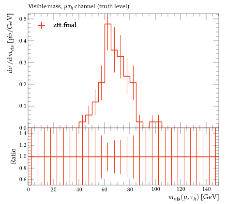
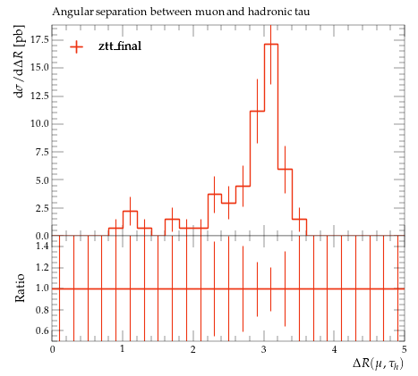

# Truth-level Z → ττ (μτ_h) analysis with Rivet

A particle-level [Rivet 4](https://heprivet.gitlab.io/) analysis of Z/γ* → ττ in the **muon + hadronic tau (μτ_h)** channel at √s = 13 TeV. It applies my M.Sc. thesis selection (CMS Open Data, detector level) to generator-level events, to see how the selection shapes the visible-mass distribution before any detector effects.

**Events:** generated by me with MadGraph5_aMC@NLO 3.6.7 + Pythia8 (LO, 10k events, m(ττ) > 50 GeV).
**Analysis:** `analysis/MC_ZTAUTAU_TRUTH.cc` (C++, Rivet 4.1.2).

<p align="center">
   
</p>

## What the routine does
1. Finds muons (pT > 20 GeV, |η| < 2.1) and hadronically decaying taus (`TauFinder`).
2. Builds the **visible** τ_h from the tau's stable decay products, leaving out neutrinos.
3. Applies the thesis cuts: visible τ_h pT > 32 GeV, |η| < 2.3; opposite charge; ΔR(μ, τ_h) > 0.5; extra-electron veto; b-jet veto (ghost-associated b-hadrons).
4. Fills m_vis(μ, τ_h), m(μ + full τ_h), muon and τ_h pT, ΔR(μ, τ_h), and a fiducial cross-section counter.

## Key results
| Quantity | Value |
|---|---|
| Generator cross-section (MadGraph LO, m(ττ) > 50 GeV) | 1493 ± 1.5 pb |
| Fiducial cross-section σ_fid (this selection) | **10.7 ± 1.3 (stat) pb** (72 of 10,000 events pass) |
| Acceptance σ_fid / σ_gen | **(0.72 ± 0.09)%** (below the μτ_h fraction, ≈ 0.23) |

- m_vis peaks at about 60–70 GeV, well below m_Z, because neutrinos from both tau decays escape.
- The τ_h pT > 32 GeV cut removes the low-mass tail (kinematic sculpting); compare the stages in `plots/`.
- ΔR(μ, τ_h) peaks near π, since the taus from a Z are roughly back-to-back.

## Run it
```bash
# inside the hepstore/rivet-tutorial:4.1.2-amd64 container
cd analysis
rivet-build RivetMC_ZTAUTAU_TRUTH.so MC_ZTAUTAU_TRUTH.cc
rivet --pwd -a MC_ZTAUTAU_TRUTH <events.hepmc.gz> -o ztt.yoda
RIVET_ANALYSIS_PATH=$PWD rivet-mkhtml ztt.yoda -o plots_ztt
```
The MadGraph cards that produced the sample are in `generation/madgraph/`.

## Limitations (honest)
- **Truth level only:** no detector simulation, no fake taus from jets, no backgrounds. This is not a comparison with data.
- **Small LO sample** (10k events): large statistical uncertainties in the tails.
- Isolation is approximated by requiring **prompt** electrons; detector-only cuts (IDs, triggers, MET filters, pileup) have no truth equivalent and are dropped.
- The muon is required to be the only one passing cuts; pairing logic is simpler than at reconstruction level.

## Repository layout
```
analysis/      my Rivet routine (.cc, .plot, .info)
generation/    MadGraph cards and the Pythia8 config from my first exercise
tutorial/      my solutions to the Rivet LHC tutorial (Ex. 1–5), ported to Rivet 4
plots/         final plots
NOTES.md       detailed walkthrough: every step, every problem and fix, all resources
```

**Full step-by-step notes, problems and fixes, and resources → [NOTES.md](NOTES.md)**

---
*Sai Sahith Neeraj Shetty — Integrated M.Sc. Physics, BIT Mesra.*
*I used Claude (an AI assistant) as a tutor while learning Rivet: for explanations, debugging and code review. Parts of the final routine (vetoes, counter, extra histograms) started from code it suggested, which I then studied and ran myself.*
